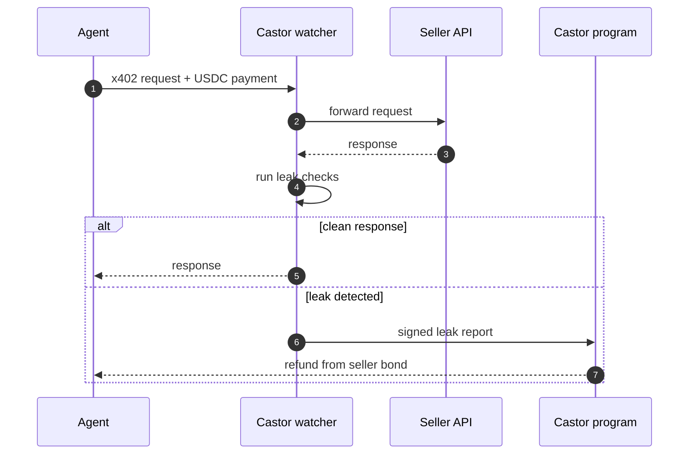

# Castor
x402 has no refund button. Castor is the refund button. Buyer protection for AI agents on Solana.
<p align="center">


<h1 align="center">Castor</h1>

<p align="center">
  <b>Buyer protection for AI agents paying over x402 on Solana.</b><br/>
  Sellers bond USDC. Leaky calls refund in seconds. Sellers still get paid instantly.
</p>

<p align="center">
  
  
  
  
  <a href="https://x.com/Castor_sol"></a>
</p>

---

## 🦫 Why Castor

x402 lets AI agents pay for APIs inside a single HTTP request. It is instant and final. That is the point, and it is also the problem.

When an API times out, throws a `500` or returns an empty or malformed body, **the agent has already paid and nobody pays it back.** x402 has no refund button.

**Castor is the refund button.**

## 🪵 How the dam works

1. **Seller builds the dam.** API sellers lock a USDC bond in the Castor program. A bigger dam means bigger coverage.
2. **Agent pays like always.** Plain x402 in USDC. It settles instantly and the seller is paid instantly. No escrow lock, no waiting.
3. **Leak? Castor gnaws the bond.** Watchers sit in the payment path and see the response first-hand. If a provable check fails, the agent is refunded from the seller's bond in seconds.



## 💧 What counts as a leak

No vibes. No oracles guessing at "quality". Only things a machine can prove, so nobody can fake a refund and nobody can dodge one.

| Check | Fires when |
|---|---|
| `timeout` | No response inside the window the seller declared |
| `status` | A 4xx or 5xx after the payment settled |
| `schema` | The response breaks the output schema the seller published |
| `empty` | `200 OK` with an empty or null payload |

## ⚡ Quickstart (SDK preview)

> Packages are not published yet. Names and APIs may change before mainnet.

**Seller: protect an endpoint**

```ts
import { castor } from "@castor/seller";

app.use("/api/weather", castor.protect({
  price: "0.01 USDC",
  checks: ["timeout:3s", "status", "schema"],
}));
```

**Agent: pay protected endpoints only**

```ts
import { withCastor } from "@castor/agent";

const pay = withCastor(x402Client, { onlyProtected: true });
const res = await pay.fetch("https://api.example.com/weather");
// leaked? the refund lands in your wallet in seconds.
```

## 🏗️ Architecture

| Component | What it does |
|---|---|
| `programs/castor` | Anchor program: seller bond vaults, coverage limits, refunds on signed leak reports |
| `watcher` | x402 facilitator / proxy that sits in the payment path and runs the leak checks |
| `sdk/seller` | Drop-in middleware for x402 sellers |
| `sdk/agent` | Wrapper for x402 agent clients |
| `catalog` | Public registry of protected endpoints with Beaver Score: leak rate, bond size, vouchers |

## 🪙 $CSTR: every beaver has a job

Bonds are USDC, so protection never depends on a token chart. $CSTR is how the colony runs.

| Role | How it works |
|---|---|
| **Watchers** | Stake to run a node in the payment path and co-sign leak reports. Earn fees; false reports get slashed. |
| **Arbiters** | Stake to settle disputes on large payments. Honest majority earns, the rest lose stake. |
| **The second dam** | Backstop pool. If a seller's bond runs dry, staked $CSTR covers the refund. Stakers earn a cut of protection fees. |
| **Vouching** | Delegate $CSTR to sellers you trust to raise their coverage and share their fees. If they leak, your stake takes the bite. |
| **Seller perks** | Lower protocol fees, catalog boost, faster path to the badge. |
| **Agent perks** | Higher coverage per call and premium checks. |
| **Governance** | Vote on what counts as a leak, fee levels, minimum bonds and catalog rules. |
| **Buybacks** | A share of every USDC protection fee buys $CSTR off the market. |

## 🗺️ Roadmap: log by log

- [ ] **Phase 01 · First log**: bond vault program, watcher proxy, timeout / status / schema checks, seller and agent SDKs, Beaver Score catalog
- [ ] **Phase 02 · The colony**: $CSTR launch, decentralized watchers with staking and slashing, seller perks
- [ ] **Phase 03 · Big water**: escrow with a challenge window for large payments, staked arbiter courts, agent coverage tiers
- [ ] **Phase 04 · Second dam**: backstop pool, vouching, buybacks, full governance

## ❓ FAQ

<details>
<summary><b>Who decides that a call leaked?</b></summary>
Watchers in the payment path observe the response first-hand. Only provable checks count. In v1 the Castor watcher signs; from Phase 02 staked watchers co-sign and are slashed for false reports.
</details>

<details>
<summary><b>Do sellers wait for their money?</b></summary>
No. The agent pays with plain x402 and the seller is paid instantly. The bond is the guarantee.
</details>

<details>
<summary><b>Can an agent fake a refund?</b></summary>
No. Refunds are triggered by what watchers observed, not by what the agent claims.
</details>

<details>
<summary><b>What if a seller's bond runs dry?</b></summary>
Coverage is capped by bond size. The seller loses the badge until it is topped up, and from Phase 04 the backstop pool covers the rest.
</details>

## 🔗 Links

- **X:** [@Castor_sol](https://x.com/Castor_sol)
- **Website:** [castorsol.xyz
- **$CSTR contract:** coming soon

## 🤝 Contributing

Castor is pre-alpha. Issues and ideas are welcome. Open an issue before starting a large change so we can build the dam in the same direction.

## 📄 License

[YOUR LICENSE]

<p align="center"><sub>Built by beavers, for agents. 🦫</sub></p>
